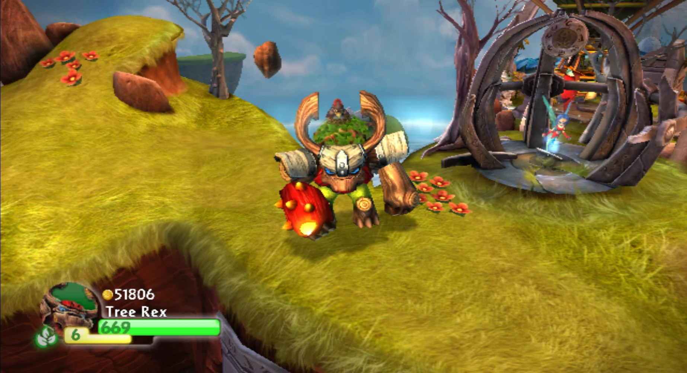
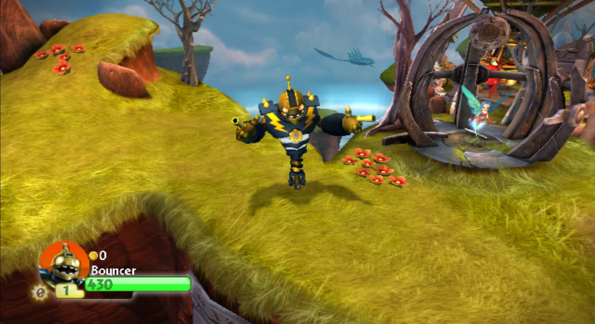

# Skylanders Giants in Spyro's Adventure (Wii)

Play the eight Giants of Skylanders: Giants in **Skylanders: Spyro's Adventure** on the Wii, with their real
figures: Swarm, Crusher, Hot Head, Thumpback, Ninjini, Bouncer, Tree Rex and Eye-Brawl, plus the variants Granite
Crusher, Scarlet Ninjini, Legendary Bouncer and Gnarly Tree Rex. Made with Claude Opus 5.5.

This repository holds **tools only**. They convert each Giant from your own Skylanders: Giants discs into Spyro's
Adventure's formats and build a patch for your own Spyro's Adventure disc. No game files are included, and none
should ever be shared: build everything yourself from your own discs.

| Tree Rex | Legendary Bouncer |
|---|---|
|  |  |

## What works

- All 8 Giants and the 4 variants, each recognised from its real figure (figure ID and variant code). A Giant
  loads its own model, animations, attacks, upgrades and upgrade pictures, sounds and voice lines, life-bar
  portrait and name.
- All six languages of the PAL release (English, French, Spanish, Dutch, German, Italian), text and voice lines.
  The game follows the console language.
- Tested in Dolphin and on a real Wii with Riivolution (disc) and USB Loader GX (patched
  image), with the real Portal of Power and with the
  [Skylanders Wii Virtual Portal](#using-it-with-the-skylanders-wii-virtual-portal).

Not included:

- The Giants' intro videos. Menus that take a character's icon or intro video from Spyro's Adventure's own
  character lists (collection screen, Heroic Challenge select, info screen) show a Spyro's Adventure Skylander of
  the same element instead.
- Small Giants-only extras: lip-sync while talking, light flashes, shaking props, Giants' per-Skylander quests.
- Battle Mode with the Giants.
- Spyro's Adventure's own limits apply, such as its maximum level of 10.

## Requirements

Your own discs, extracted with Dolphin (see Setup):

| Game | Disc | `sys/main.dol` SHA-256 |
|---|---|---|
| Skylanders: Spyro's Adventure, PAL | `SSPP52`, disc revision 2 | `6f4be21bd83c7072e566f1e813392b755fd27371026b8dae5c49d56c2d20c09f` |
| Skylanders: Giants, PAL German/Spanish/Italian | `SKYZ52` | `8a538ccfa2d5e98778114345c4ce503dc1c983b53befc1b53cda59c5812a6821` |
| Skylanders: Giants, PAL English/French/Dutch | `SKYP52` | same as `SKYZ52` |

Each Giants disc holds three of the six languages, so both are needed: the Giants' text and voices in Spanish,
German and Italian come from `SKYZ52`, in English, French and Dutch from `SKYP52`. Everything else comes from
`SKYZ52`. Other regions and revisions have not been tried; the memory patch checks the value it replaces.

Software:

- Python 3 (developed with 3.14), no extra packages (the optional figure reader `tools/figure.py` needs
  `pycryptodome`).
- [Dolphin](https://dolphin-emu.org), to extract the discs and to play or test on a PC.
- On a Wii: the Homebrew Channel, and [Riivolution](https://rvlution.net/riivolution) (with the disc),
  or USB Loader GX with [Wiimms ISO Tools](https://wit.wiimm.de) (a patched image).

## Setup

1. **Extract the three discs** in Dolphin: right-click the game > **Properties** > **Filesystem** > right-click the
   disc > **Extract Entire Disc...**. Each extraction has a `DATA` folder holding `sys/` and `files/`.
2. **Tell the tools where they are**: create `paths.local.json` in this folder (it is not tracked by git):

   ```json
   {
     "SSA_ROOT": "D:/Wii/SSPP52/DATA",
     "GIANTS_ROOT": "D:/Wii/SKYZ52/DATA",
     "GIANTS_EN_ROOT": "D:/Wii/SKYP52/DATA"
   }
   ```

   Environment variables with the same names work too. `DOLPHIN_USER` sets Dolphin's user folder if it is not
   `%APPDATA%\Dolphin Emulator`.
3. **Build**:

   ```bash
   python tools/build_tests.py --install
   ```

   This converts the 12 characters, checks every written file, writes the patch to `build/riivolution/` and
   installs it into Dolphin's `Load/Riivolution` folder. It takes about 10 minutes, plus about a minute per
   patched level the first time (29 levels, then kept in `build/level_cache/`).

## Playing

### In Dolphin

Right-click Skylanders: Spyro's Adventure > **Start with Riivolution Patches...**, set **Skylanders Giants port >
Giants** to **Enabled** and start. Put figures on the emulated portal in **Tools > Skylanders Portal** (**Create**
makes new ones). The language is in **Config > Wii > System Language**.

### On a Wii with Riivolution

Copy the patch to the root of a FAT32 SD card (here `E:\`):

```bash
python tools/build_tests.py --no-build --sd E:\
```

This writes `riivolution/GiantsPort.xml` and `giants-port/` (about 520 MB; later runs copy only what changed).
Put Riivolution in `apps/riivolution/` on the card, start it from the Homebrew Channel, set
**Skylanders Giants port > Giants** to **Enabled** and launch. Riivolution needs the disc in the drive.
The language is **Wii Settings > Language**.

### On a Wii with USB Loader GX

Bake the patch into a copy of the game and build a WBFS image (needs Wiimms ISO Tools):

```bash
python tools/bake_image.py
```

This writes `build/image/SSPP52.wbfs`: the patch's files written into a copy of your extracted disc, and its memory
patch into `main.dol`. Add it to your game drive with Wii Backup Manager. It keeps the game ID `SSPP52`, so it
replaces your Spyro's Adventure backup and uses the same save; the other Skylanders play as before. Use your usual
Game IOS. `--iso` builds an ISO instead, `--split` splits it for copying to a FAT32 drive by hand.

## Using it with the Skylanders Wii Virtual Portal

The [Skylanders Wii Virtual Portal](https://github.com/xirba13/Skylanders-Wii-Virtual-Portal) replaces the
Portal of Power with figure dumps on the SD card. It works through USB Loader GX: a custom IOS provides the
portal, and an **alternate DOL**, `sd:/SSPP52.dol`, adds its in-game menu. A game started with an alternate DOL
ignores the `main.dol` inside the image, and with it this port's memory patch. The Giants then never finish
loading: the portal screen keeps showing their element.

To use both:

1. Build the patched image with `python tools/bake_image.py` and put it on your game drive (see above). It is
   still needed: it holds the Giants' files.
2. Make the Virtual Portal's `SSPP52.dol` from your own `main.dol` and install its custom IOS, as its README
   explains.
3. Add this port's memory patch to that DOL:

   ```bash
   python tools/bake_image.py --patch-dol path/to/SSPP52.dol path/to/SSPP52.dol
   ```

   The two patches do not overlap: the Virtual Portal adds a code section at `0x80001800` and five hooks, and this
   port changes one word, the character memory budget at `0x8054210C` (`0x00100000` to `0x00180000`). The
   result differs from the Virtual Portal's DOL by one byte. A DOL that already has the patch is left as it is.
4. Put it at `sd:/SSPP52.dol` and set USB Loader GX as the Virtual Portal's README says (Game IOS 252, Alternate
   DOL from SD/USB, path `sd:/`, Ocarina off, Hooktype none).
5. Load your Giants' dumps from the Virtual Portal's menu.

Run step 3 again whenever you rebuild the Virtual Portal's DOL. Its manifests record the hash of its own DOL, so
its verification tools will report the patched one as different; nothing checks it at run time. Riivolution
does not use an alternate DOL, so the Virtual Portal's menu is not available there: use the real portal with it.

## Figures and saves

On real hardware the game writes to the figures you place. In every figure file examined so far (Dolphin's),
Spyro's Adventure writes only its own save blocks (8-16 and 36-44), never the blocks where Giants keeps its own
data (17-21 and 45-49). Back up figures you care about if you can. The Giants' collection flags use bits of Spyro's
Adventure's save that it does not use itself, so the save format does not change.

## How it works

- `tools/convert_character.py` converts each Giant's `character/*.bld` and `.arc`: Giants' IGZ v6 objects to
  Spyro's Adventure's v5 layouts, Havok 2011 skeletons and animations to Havok 7.1, FSB5 sounds to FSB4, ability
  pictures and portraits to Spyro's Adventure's conventions, and the scripts to Spyro's Adventure's macros (some
  of Giants' macros are copied in as local macros).
- `tools/giants.py` and `tools/variants.py` add the Giants and the variants to the toy table
  (`misc/Init_Setup.bld`), the character list and the language packs (`permanent/global.bld`), and the menu sets.
- `tools/level_fixes.py` gives the 29 levels with push blocks Giants' push reach, so the Giants can push them.
- A Giant needs more memory than any Spyro's Adventure character: the patch raises the character budget's second
  memory pool from 1 MB to 1.5 MB (`main.dol` `0x8054210C`).
- `tools/build_tests.py` builds and checks everything (every written file must pass the IGZ and reference-count
  checks); `tools/bake_image.py` makes the USB loader image.

[docs/FORMATS.md](docs/FORMATS.md) documents the file formats and everything the port had to change, with the
evidence. [docs/TESTS.md](docs/TESTS.md) is the history of the 41 test builds and their results.

## Repository layout

| Path | Purpose |
|---|---|
| `tools/build_tests.py` | Build the patch, check it, install it into Dolphin or onto an SD card |
| `tools/bake_image.py` | Bake the patch into a disc image or into another DOL |
| `tools/convert_character.py`, `convert.py`, `hkconvert.py`, `fsb.py`, `gxtex.py` | The character converter |
| `tools/script_fixes.py`, `macro_port.py`, `script_edit.py` | Script fixes and macro ports |
| `tools/giants.py`, `variants.py`, `langpack.py`, `minions.py`, `level_fixes.py` | Edits to Spyro's Adventure's own files |
| `tools/iga.py`, `igzdoc.py`, `igz.py`, `igzobj.py`, `hkpack.py`, `refcounts.py` | Archive, IGZ and Havok readers and writers |
| `tools/figure.py` | Decrypt a figure dump and show its save fields |
| `tools/paths.py` | Where your extracted discs and Dolphin are |
| other `tools/*.py` | Research helpers used to work out the formats. A few read the generated assembly of a Spyro's Adventure decompilation project; set `SSA_DECOMP` to its folder to use them |
| `docs/FORMATS.md`, `docs/TESTS.md` | Format notes and test history |
| `docs/images/` | The screenshots above |

## Legal

This is an unofficial fan project, not affiliated with or endorsed by Activision, Toys for Bob or Nintendo. Skylanders is a trademark of Activision. The repository contains no game data: the tools read your own
discs, and what they build (`build/`, the SD card folders, patched images and DOLs) must not be distributed.

## Credits

Made with Claude Opus 5.5 (Anthropic), with testing in Dolphin and on real hardware.

Thanks to the projects this relies on: Dolphin (its Skylanders portal emulation and figure format code),
Riivolution by Aaron, tueidj, Tempus and megazig, Wiimms ISO Tools, USB Loader GX and Wii Backup Manager, and the
Skylanders figure format documentation at marijnkneppers.dev.
